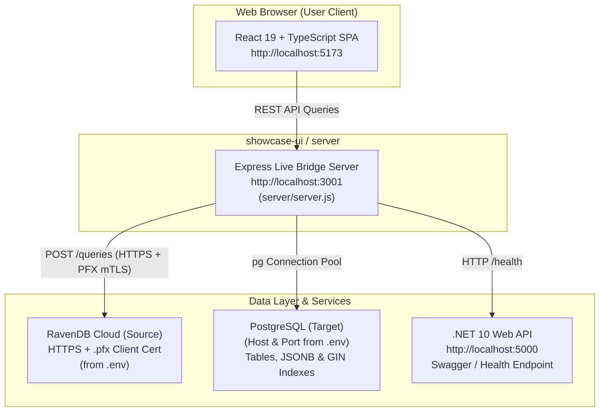

# 🖥️ CT-RPG Live Migration Studio

> **Interactive Real-Time Parity Studio** for inspecting live data transformation between **RavenDB Cloud (NoSQL)** and **PostgreSQL (Relational + JSONB)** alongside the **ASP.NET Core 10 Web API**.

---

## 🎯 Overview & Purpose

**CT-RPG Migration Studio** is a real-time, browser-based studio that connects directly to your live database instances to:
- Inspect live RavenDB documents side-by-side with target PostgreSQL rows with **1:1 deterministic record matching**.
- Explore live business domains with real database row and document counts.
- Inspect dynamically generated PostgreSQL `CREATE TABLE` DDL, active triggers, and GIN indexes.
- Chat with an **AI Copilot** for domain schemas, RQL-to-SQL translations, and `LATERAL jsonb_array_elements` queries.

---

## 🏛️ Architecture: How Everything Connects

The system consists of a **React 19 Frontend** and an **Express Live Bridge Server** that talks directly to RavenDB Cloud and PostgreSQL.



### Real-Time Data Flow:
1. **Health & Latency Heartbeat**: The React app polls `GET /api/live/status` every 8 seconds, measuring live round-trip latency to RavenDB Cloud and PostgreSQL.
2. **Domain Selection**: Selecting any domain triggers:
   - `GET /api/live/raven/:collection?limit=all`: Queries RavenDB documents via `from "<Collection>" order by id()` over mTLS.
   - `GET /api/live/postgres/:table?limit=all`: Queries PostgreSQL rows via `SELECT * FROM <table> ORDER BY id ASC`.
3. **1:1 Record Alignment**: Because both data sources are queried with deterministic ID ordering, Record #1 in the RavenDB pane corresponds exactly to Row #1 in the PostgreSQL pane.
4. **Dynamic DDL & Triggers**: The backend queries PostgreSQL's `information_schema.columns` and `information_schema.triggers` to generate the exact DDL and trigger definitions live.

---

## 🚀 Quick Start: Steps to Run

### Prerequisites
- [Node.js](https://nodejs.org/) (version 18 or higher)
- [npm](https://www.npmjs.com/) (bundled with Node.js)
- PostgreSQL running locally or via Docker (`docker compose up -d rpg-postgres`)
- RavenDB client certificate `.pfx` in `scripts/certs/`

---

### Step 1: Install Dependencies

```bash
cd showcase-ui
npm install
```

---

### Step 2: Configure Environment (.env)

Ensure your `.env` file in the project root contains your database credentials:

```ini
# PostgreSQL Target
PG_HOST=localhost
PG_PORT=5433
PG_DB=rpg
PG_USER=postgres
PG_PASSWORD=your_postgres_password

# RavenDB Cloud Source
RAVEN_URL=https://your-ravendb-cluster-url
RAVEN_DB=your_database_name
RAVEN_CERT_FILE=certs/your_client_certificate.pfx
RAVEN_CERT_PASSWORD=your_cert_passphrase_if_any
RAVEN_INSECURE=false

# Port configurations
SERVER_PORT=3001
API_PORT=5000
```

---

### Step 3: Start the Express Live Backend Bridge

In **Terminal 1**:

```bash
# Inside showcase-ui/
npm run server
```

You should see:
```text
=======================================================
⚡ CT-RPG Live Backend Bridge listening on port 3001
   - PostgreSQL: Host=localhost, Port=5432, DB=(from .env)
   - RavenDB: Configured=true, CertLoaded=true
=======================================================
```

---

### Step 4: Launch the React Frontend

In **Terminal 2**:

```bash
# Inside showcase-ui/
npm run dev
```

Open your browser at:
👉 **`http://localhost:5173`**

---

## 🎨 UI Feature Walkthrough

### 1. Header & Live Health Badges
- **Status Pills**: Live connection indicators for **RavenDB Cloud**, **PostgreSQL**, and **.NET 10 API** displaying active ping latency in milliseconds.
- **LIVE DB Tag**: Clear visual confirmation that all panes are rendering direct database queries.
- **Audit Domain Pill**: Shows total audited domains and live record counts.
- **Verify Parity Button**: Triggers a verification check with visual feedback.

### 2. Domain & Record Selector
- **Dynamic Domain Tabs**: Inspect discovered live business collections.
- **Discovered Domains Dropdown**: Instant access to all collections and tables discovered live across both databases.
- **Record Pagination**: Step forwards and backwards (`<` `>`) through individual live records.

### 3. Parity Status Bar
- Displays:
  - Live RavenDB document count
  - Live PostgreSQL row count
  - Match count & missing/extra record alerts
  - Clean status badge (100% MATCH or AWAITING SYNC)

### 4. Dual-Pane Split View
- **Left Pane (RavenDB Document Store)**:
  - `Document JSON`: Formatted JSON payload with syntax colorization.
  - `@metadata`: CLR type, Change Vectors, and timestamps.
  - `RQL Query`: The exact RavenDB Query Language query used to fetch the document.
  - `Source Stats`: Collection size, document counts, and storage metrics.
  - `Copy`: 1-click clipboard button.
- **Right Pane (PostgreSQL Relational + JSONB)**:
  - `Row Columns`: Tabular view of all relational columns, showing column names, inferred data types, and values.
  - `JSONB Columns`: Dedicated explorer for JSONB attributes with nested expand/collapse controls.
  - `Table DDL`: Live generated PostgreSQL `CREATE TABLE` and `CREATE INDEX` schema.
  - `SQL Query`: The corresponding SQL query.
  - `Triggers`: PostgreSQL trigger functions (e.g., automatic `modified_on` timestamp updates).

### 5. AI Migration Copilot
Floating drawer in the bottom-right corner:
- Interactive chat assistant with context of the currently selected domain.
- **Quick Action Prompts**:
  - `⚡ Schema Mapping`: Generates and explains live DDL from PostgreSQL catalog.
  - `🔍 Parity Audit`: Analyzes records for live data integrity.
  - `🔄 RQL ➔ SQL`: Demonstrates query conversion from RavenDB RQL to PostgreSQL SQL.
  - `📊 JSONB LATERAL`: Explains PostgreSQL `LATERAL jsonb_array_elements` queries.

### 6. Live Parity Audit Modal
Clicking the header metric pill opens the complete audit view:
- Lists all discovered database domains with **live RavenDB counts** and **live PostgreSQL counts**.
- Displays real-time parity verification status.

---

## 📡 API Endpoints Reference (Live Bridge)

The live server runs on `http://localhost:3001`:

| Method | Endpoint | Description |
| :--- | :--- | :--- |
| `GET` | `/api/live/status` | Pings PostgreSQL, RavenDB Cloud, and .NET API; returns latency. |
| `GET` | `/api/live/domains` | Returns all discovered domains with live document counts from RavenDB and PG. |
| `GET` | `/api/live/raven/:collection?limit=all` | Queries live documents from RavenDB via `from "<Collection>" order by id()`. |
| `GET` | `/api/live/postgres/:table?limit=all` | Queries live rows, dynamic DDL, column types, and triggers from PostgreSQL. |
| `GET` | `/api/live/raven-doc?id=<doc_id>` | Fetches a single RavenDB document by its exact `@id`. |
| `GET` | `/api/live/summary-view?limit=all` | Queries the PostgreSQL cross-module view `student_fee_summary_view`. |

---

## ❓ Troubleshooting & FAQs

### Q1: The frontend shows "Offline" for RavenDB or PostgreSQL.
- **Verify Express Server**: Ensure `npm run server` is running in your terminal on port 3001.
- **Check Credentials in `.env`**: Make sure `PG_PASSWORD` and `RAVEN_CERT_FILE` in your root `.env` are correct.
- **PostgreSQL Port**: In this repository, Docker PostgreSQL is bound to port `5433` on the host to avoid conflicting with a default local Postgres on `5432`.

### Q2: How do records stay aligned between RavenDB and PostgreSQL?
The backend queries both data sources with deterministic ID ordering (`from "<Collection>" order by id()` in RavenDB and `ORDER BY id ASC` in PostgreSQL). Since RavenDB document IDs match PostgreSQL primary keys, Record #1 in RavenDB corresponds directly to Row #1 in PostgreSQL.

---

*Part of the CT-RPG Migration Suite.*
